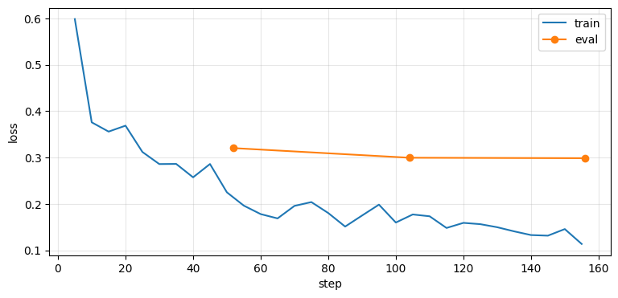

# Эксперименты

## Постановка

Полное SFT модели Qwen2.5-0.5B-Instruct для пяти функций умного дома. Обучение на 831 диалоге, валидация на 91. Тест содержит 40 английских и 20 русских примеров.

Конфигурация в [ноутбуке](sft_function_calling_hw.ipynb): 3 эпохи, learning rate `2e-5`, batch 8, accumulation 2, BF16, seed 42, длина до 2048 токенов. Обучаются все веса. Маска включает текст ассистента, вызовы функций и `<|im_end|>`; сообщения system, user и результаты инструментов исключены из loss. Проверочная ячейка подтверждает, что теги маски не изменили текст примера.

## Результаты

В сохраненном запуске validation loss снизился с 0.3202 после первой эпохи до 0.2995 после второй и 0.2985 после третьей. Train loss продолжал снижаться; к концу улучшение на validation почти прекратилось. Снижение loss само по себе не подтверждает правильность вызовов.

| Модель | Язык | Tool set accuracy | Exact match |
|---|---|---:|---:|
| Base | EN | 30/40 · 0.75 | 22/40 · 0.55 |
| SFT | EN | 38/40 · 0.95 | 36/40 · 0.90 |
| Base | RU | 15/20 · 0.75 | 4/20 · 0.20 |
| SFT | RU | 17/20 · 0.85 | 16/20 · 0.80 |

Метрики взяты из [eval_results.csv](outputs/eval_results.csv) и совпадают с таблицей ноутбука. Tool set accuracy сравнивает множества имен функций. Exact match учитывает аргументы и повторные вызовы, но не порядок; пропущенное `quantity=1` равнозначно явному. Для запросов без вызова обе метрики проверяют отсутствие вызовов, а не содержание ответа.

После SFT запрос `Turn off all lights.` дает три вызова по комнатам вместо несуществующей комнаты `all`. На `Open the garage.` модель отвечает отказом, на `Turn on the light.` уточняет комнату. Есть и регрессия: два пакета молока добавляются двумя вызовами по одному вместо одного вызова с `quantity=2`. Все десять пар ответов сохранены в [comparison.json](outputs/comparison.json) и ноутбуке.

## Агентный цикл

`run_agent` выполняет каждый вызов в `SmartHome`, добавляет ответ инструмента в историю и продолжает генерацию. Остановка происходит при текстовом ответе без вызовов или после четырех шагов.

В пяти сохраненных сценариях свет включается, два вызова за ход выполняются, благодарность и запрос про гараж не вызывают инструменты. При относительном изменении температуры модель сначала задает лишний вопрос. После уточнения читает состояние спальни и повышает температуру с 21 до 23. Два последовательных повышения на 2 градуса не выполнены. Повторное выполнение сохраненных вызовов в симуляторе воспроизводит все пять итоговых состояний.

## Выводы

SFT повысило exact match с 0.55 до 0.90 на EN и с 0.20 до 0.80 на RU. Ошибки аргументов и выбора функций остаются; агентный цикл корректно исполняет вызовы, но не исправляет решение модели.

В train и validation нет полностью одинаковых диалогов. В семи тестовых примерах есть пользовательские реплики из train при сравнении без учета регистра и крайних пробелов; в двух совпадает только часть многоходового контекста. Тест небольшой и не полностью независим. Отдельные ответы на все 60 тестовых примеров не сохранены, поэтому агрегаты сверены с ноутбуком, но заново по предсказаниям не пересчитаны. Новое обучение и генерация при подготовке отчета не запускались.
