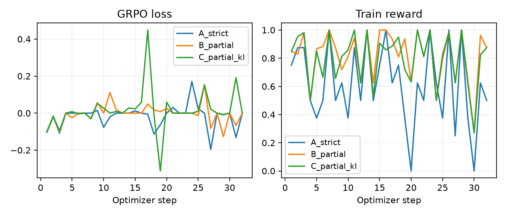

# Эксперименты ДЗ5

На учебном BFCL лучший результат в этом запуске дал strict reward: **0.7173** против **0.6827** у baseline. Partial получил 0.7040; partial с усиленным KL - 0.6787. Это один seed и короткий бюджет, устойчивость такого ранжирования не проверена.

## Постановка

Qwen/Qwen3.5-2B, ревизия `15852e8c16360a2fea060d615a32b45270f8a8fc`. Только RL на Team-ACE/ToolACE, без SFT. Train/validation: 10 731 / 1 165 решений, разделённых по исходным диалогам. 500 нестандартных диалогов и продолжения после tool исключены. Подготовка и ограничения источника - в [EDA.md](EDA.md).

GRPO + LoRA r=16, alpha=32, LR 1e-5, BF16, training/data seed 42, штатный vLLM rollout seed 0. По 32 optimizer steps, 4 rollout на prompt, 2 исходных prompts на шаг: около 64 prompts (0.6% train) на конфигурацию. Порядок данных и остальные настройки одинаковы. Чекпойнт выбран по common strict на одной фиксированной подвыборке из 64 validation-примеров на шагах 16/32; во всех трёх запусках выбран шаг 32. BFCL не использовался для выбора шага или настройки обучения.

## Результаты

| Вариант | KL | BFCL overall | Val strict | Val partial | Нулевой advantage |
|---|---:|---:|---:|---:|---:|
| baseline | - | 0.6827 | 0.6266 | 0.7998 | - |
| A_strict | 0.02 | 0.7173 | 0.6361 | 0.7903 | 44/64 |
| B_partial | 0.02 | 0.7040 | 0.6395 | 0.7980 | 41/64 |
| C_partial_kl | 0.10 | 0.6787 | 0.6403 | 0.8063 | 38/64 |

BFCL overall усредняет группы и подкатегории, а не просто correct/350. Evaluator, benchmark и финальные параметры генерации не менялись. Перед оценкой LoRA объединена с исходными весами; для каждого варианта сохранены `metrics.json` и `predictions.jsonl`.

Loss относится к GRPO, определения strict/partial reward различаются. Высоты reward-кривых напрямую не сравниваются. В 44/64 группах A, 41/64 B и 38/64 C все rollout-награды совпали: относительный policy advantage равен нулю. В 15, 14 и 11 шагах соответственно обе группы имели нулевой advantage; KL при этом мог продолжать менять веса. Partial немного уменьшил число таких групп, но это не обеспечило лучший BFCL.

## Ошибки и перенос

| Группа BFCL | Baseline | A | B | C |
|---|---:|---:|---:|---:|
| simple | 0.680 | 0.720 | 0.720 | 0.680 |
| multiple | 0.793 | 0.807 | 0.800 | 0.753 |
| parallel | 0.540 | 0.660 | 0.620 | 0.580 |
| parallel_multiple | 0.800 | 0.800 | 0.800 | 0.740 |
| irrelevance | 0.600 | 0.600 | 0.580 | 0.640 |

У A основной прирост - parallel: 0.54 → 0.66; irrelevance остался 0.60. A исправил 16 baseline-ошибок и добавил 6 новых; B - 11 и 5; C - 7 и 12. В `parallel_1` baseline не выдал разобранных вызовов, A вернул два корректных. В `live_multiple_460-145-11` A пропустил `category="Park"`, и правильный ответ baseline стал ошибкой. В `parallel_103` обе модели не выдали ожидаемый вызов. Все категории и примеры ошибок - в [error_analysis.json](runs/run_02/error_analysis.json).

C получил лучшие ToolACE validation strict/partial, но не улучшил BFCL. Средний train KL у B составил 0.000827, у C - 0.000539; усиление регуляризации в этом коротком запуске не помогло переносу на BFCL. Свободный текст no-call по содержанию не оценивался, кроме требования непустого корректного ответа без вызовов.

## Проверки и воспроизведение

EDA повторён побайтово; проверены отсутствие пересечений диалогов/prompts и длины экспортов. Все 9 603 эталона с вызовами прошли полный round trip через реальный Qwen template и vLLM parser. Шесть reward-проверок покрывают повторы, лишние/пропущенные вызовы и аргументы, вложенность, bool/числа/строки, malformed XML, no-call, EOS-only и обрезание.

Агрегаты BFCL независимо пересчитаны из 350 предсказаний для всех четырёх вариантов; final validation содержит ровно 1 165 исходных ID. Проверены ревизии, SHA256 данных, неизменность decoding и одинаковые configs вне reward/KL. [Результат проверки](runs/run_02/verification.json), [команды](RUNBOOK.md), [PDF](report.pdf). Диагностический 128-step запуск намеренно остановлен после 10 шагов и не входит в сравнение.

Полные веса и адаптеры сохранены отдельно от обычного Git. Для воспроизведения нужны исходный Dockerfile, `eda.py`, configs и `run_pipeline.py`; `merge.py` экспортирует полные веса. Старые домашние задания не менялись.
