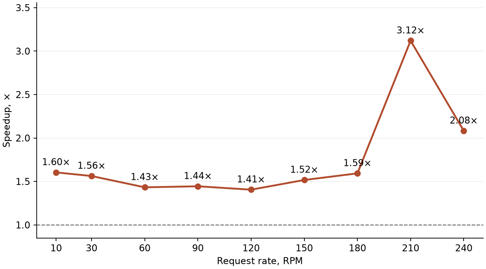
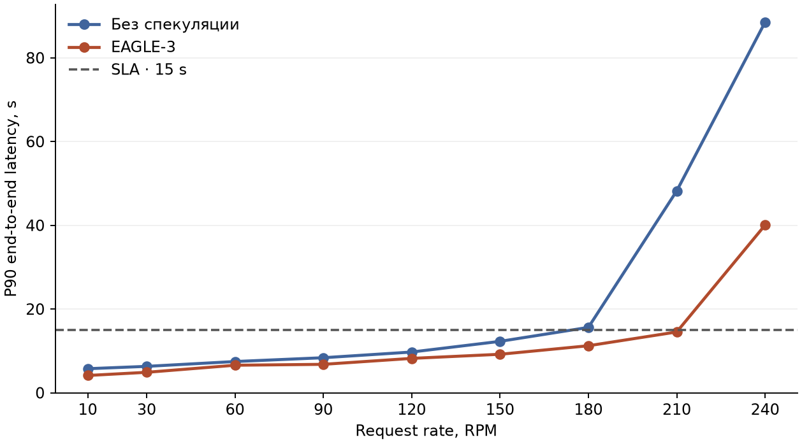

# ДЗ 6. Ускорение инференса Qwen3-8B

Я запустил Qwen3-8B в vLLM 0.22.0 на одной A100 80 ГБ. AIPerf 0.13.0 подавал 640 запросов курса равномерно по 120 RPM. Перед замером — очистка prefix cache и 40 запросов на прогрев. Reasoning выключен, температура 0, seed 42, лимит ответа 512 токенов.

## Что менял при 120 RPM

Сначала я менял два параметра планировщика. `max_num_seqs` ограничивает число запросов в одном шаге, `max_num_batched_tokens` — суммарное число токенов на этом шаге.

| Конфигурация | `max_num_seqs` | `max_num_batched_tokens` | Mean latency, s | P90, s | Успешно из 640 |
|---|---:|---:|---:|---:|---:|
| Baseline | default | default | 6,89 | 9,72 | 640 |
| vLLM | 8 | 2048 | 65,93 | 115,79 | 537 |
| vLLM | 8 | 8192 | 65,89 | 115,79 | 540 |
| vLLM | 32 | 2048 | 6,89 | 9,76 | 640 |
| vLLM | 32 | 8192 | 6,88 | 9,65 | 640 |

**Очередь зависела от `max_num_seqs`.** При 8 и бюджете 2048 в очереди накопилось до 202 запросов, у 103 истёк тайм-аут. При 32 и том же бюджете очередь оставалась пустой. Увеличение бюджета с 2048 до 8192 почти не повлияло на latency. В таблице latency посчитана по завершённым запросам.

При тех же 32 и 8192 я отдельно проверил EAGLE-3 и FP8. В каждом прогоне завершились все 640 запросов. Speedup — отношение mean end-to-end latency стандартного vLLM к результату прогона.

| Параметр vLLM | Что меняется | Mean latency, s | P90, s | Speedup |
|---|---|---:|---:|---:|
| `method=eagle3` | Обученный для Qwen3-8B черновик предлагает до 3 токенов. Основная модель проверяет их за один проход | **4,89** | 8,19 | **1,41×** |
| `--quantization fp8` | На A100 vLLM хранит веса в 8-битном формате. Для умножения с такими весами движок выбрал GPU-ядро Marlin | 5,79 | 7,42 | 1,19× |

**EAGLE-3 ускорил выдачу токенов.** Средняя длина ответа осталась около 420 токенов, а inter-token latency снизилась с 16,04 до 11,34 ms.

**FP8 дал меньшую latency, но испортил ответ.** Например, запрос из набора курса — «Напиши объёмный доклад на тему интересные факты про Землю и Марс». Ниже фрагменты ответов на него.

- **Baseline:** «Земля и Марс — две планеты, которые вдохновляют умы человечества уже тысячи лет».
- **FP8:** `,rpfsputr或多POSIT螨 First CoryValuePairuem是一项/proto真假不克OOT`

Поэтому для нагрузочного теста я выбрал EAGLE-3.

## Ускорение EAGLE-3 при разной нагрузке

Для каждой точки я подавал запросы равномерно в течение 300 секунд. В обоих режимах использовал `max_num_seqs=32` и `max_num_batched_tokens=8192`. Все 18 прогонов завершились без ошибок.

Для каждой нагрузки я разделил mean end-to-end latency без спекуляции на mean end-to-end latency с EAGLE-3. При 10 RPM получилось **1,60×**, при 30 RPM — **1,56×**. Максимум на сетке — **3,12× при 210 RPM**.

## Нагрузочное тестирование

Из девяти проверенных нагрузок выбрал максимальную, при которой P90 end-to-end latency < 15 s.

| Request rate, RPM | P90 без спекуляции, s | P90 с EAGLE-3, s |
|---:|---:|---:|
| 10 | 5,75 | 4,13 |
| 30 | 6,31 | 4,89 |
| 60 | 7,46 | 6,58 |
| 90 | 8,37 | 6,79 |
| 120 | 9,73 | 8,22 |
| 150 | 12,28 | 9,20 |
| 180 | 15,62 | 11,23 |
| 210 | 48,21 | 14,53 |
| 240 | 88,51 | 40,05 |

**При 210 RPM** без спекуляции в очереди ждали до 129 запросов, с EAGLE-3 — до 14. При 240 RPM очередь с EAGLE-3 тоже выросла до 127 запросов. P90 достиг 40,05 s при SLA < 15 s.

## Итог

При 120 RPM EAGLE-3 снизил mean end-to-end latency с 6,89 до 4,89 s (**1,41×**). P90 с EAGLE-3 был ниже на всех девяти точках. Максимальная проверенная нагрузка при P90 < 15 s выросла со **150 до 210 RPM**.

[Таблица замеров](outputs/measurements.csv)
